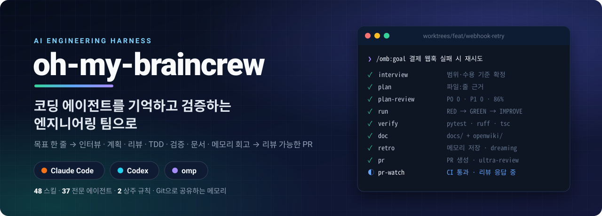
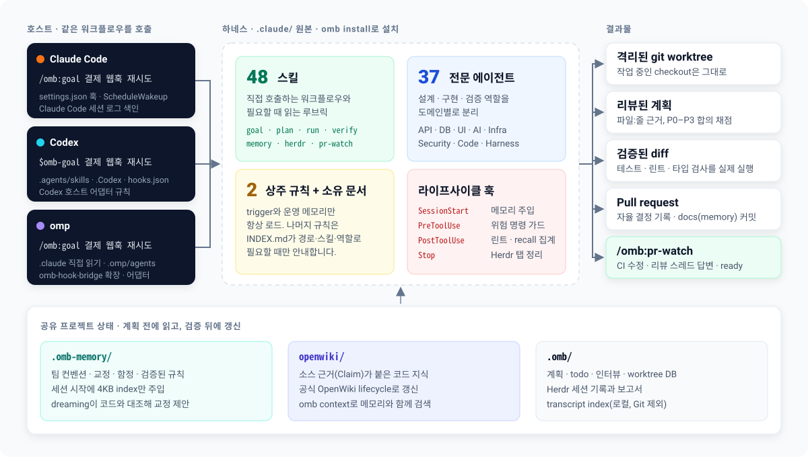
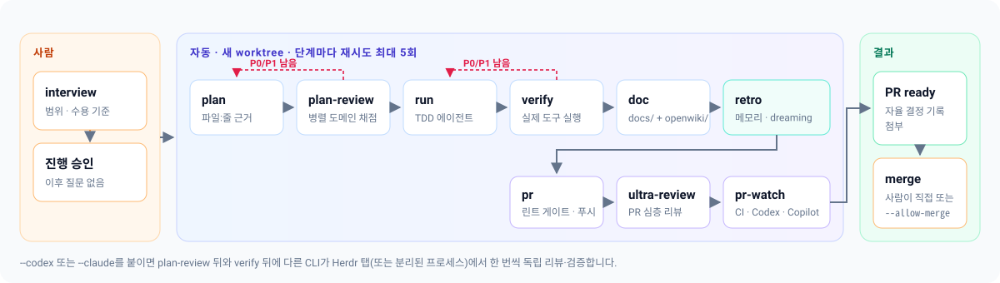
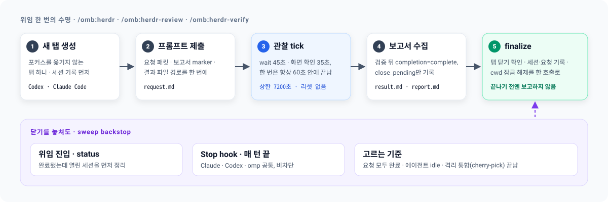
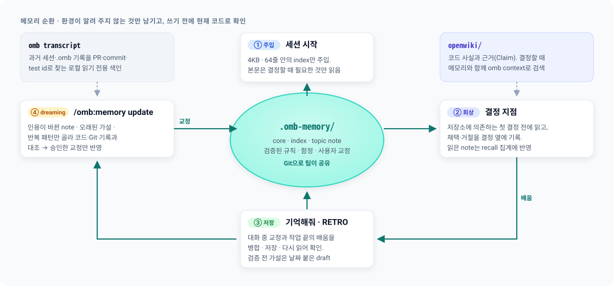

<div align="center">



<br>

**Claude Code, Codex, omp를 계획·리뷰·구현·검증·PR까지 해내고, 프로젝트의 작업 방식을 기억하는 엔지니어링 팀으로 바꿉니다.**

[](https://github.com/braincrew-lab/oh-my-braincrew-release/releases/latest)
[](https://github.com/braincrew-lab/oh-my-braincrew-release/releases)
[](#설치)
[](#지원-호스트)
[](#세션이-끝나도-남는-메모리)
[](#라이선스)

[빠른 시작](#빠른-시작) · [2.1.0의 새 기능](#210의-새-기능) · [동작 방식](#동작-방식) · [지원 호스트](#지원-호스트) · [워크플로우](#워크플로우) · [명령어](#명령어) · [메모리](#세션이-끝나도-남는-메모리) · [변경 기록](CHANGELOG.md) · [English](README.md)

</div>

---

코딩 에이전트 하나가 한 컨텍스트에서 일하면 코드를 쓰고, 테스트를 건너뛰고, 다 됐다고 말하기 쉽습니다. **oh-my-braincrew(`omb`)** 는 그 에이전트 주위에 하네스를 설치합니다. 워크플로우 스킬 48개, 전문 에이전트 37개, 경로별로 필요할 때 읽는 규칙, 라이프사이클 훅이 함께 에이전트를 절차가 있는 팀처럼 일하게 합니다.

목표를 말하면 하네스가 인터뷰하고, 실제 파일 위치를 근거로 계획을 쓰고, 도메인 리뷰어에게 점수를 받고, 격리된 worktree에서 테스트 먼저 구현하고, 실제 타입 검사·린터·테스트를 돌린 뒤 PR을 엽니다. 작업 중 내린 결정과 교훈은 Git으로 공유되는 메모리에 남아 다음 세션과 다음 팀원에게 이어집니다.

```text
> /omb:goal 결제 웹훅 실패 시 지수 백오프로 최대 5회 재시도
```

## 2.1.0의 새 기능

| 변경 | 달라지는 점 |
|---|---|
| **omp(oh-my-pi) 지원** | `omb install`·`update`가 omp용 에이전트(`.omp/agents/omb-*.md`), 어댑터·상주 규칙(`.omp/rules/`), 훅 브리지 확장(`.omp/extensions/omb-hook-bridge/`)을 생성합니다. 스킬과 `/omb:*` 명령은 omp가 `.claude/`에서 직접 읽습니다. 보안·품질 훅, 메모리 주입, 역할별 Bash 게이트가 omp 세션에서도 동작합니다 |
| **메모리가 워크플로우에 연결** | interview·plan·run·verify 등 워크플로우 스킬이 저장소에 의존하는 첫 결정 전에 메모리를 읽고, 끝날 때 재사용할 배움을 저장합니다. `/omb:goal`·`/omb:refactoring`에 DOC 다음 **RETRO** 단계가 생겨 결정과 교훈을 저장하고 dreaming을 한 번 돌린 뒤 같은 PR에 `docs(memory)` 커밋 하나를 남깁니다 |
| **Herdr 탭 자동 정리** | 위임이 끝나면 `finalize` 한 호출로 탭을 닫고 기록과 잠금을 정리합니다. 닫기를 놓친 세션은 위임 진입·`status`와 매 턴 끝의 비차단 `Stop` hook이 찾아 닫습니다. 여러 위임을 동시에 띄워도 돌아가며 관찰하고 끝난 것부터 닫습니다 |
| **호스트별 대기 보장** | Herdr 관찰 tick과 PR 감시 대기가 60초를 넘지 않게 나뉘어, 60초를 넘는 명령을 백그라운드로 옮기는 omp에서도 턴이 끊기지 않습니다 |
| **메모리 호스트 진단** | `omb memory status --host omp`를 지원하고, `status --json`의 `warning_kinds`로 경고 종류를 구분합니다. `/omb:clean`은 dreaming이 필요할 때만 `/omb:memory update`를, 기록이 쌓였을 때는 `omb retention plan`을 안내합니다 |
| **OpenWiki 공식 기능 연결** | 여러 저장소 wiki 검색(`openwiki_search`·`openwiki_read`), `INSTRUCTIONS.md`·`.openwikiignore` 조정, 언어 상속, 진단을 OMB 경로에 연결했습니다 |

전체 항목은 [CHANGELOG](CHANGELOG.md)에 있습니다. 2.0.0 이전 버전에서 올라오면 [2.0.0 업그레이드 주의 사항](#200-업그레이드-주의-사항)도 확인하세요.

## omb를 쓰는 이유

| 에이전트 혼자 | omb와 함께 |
|---|---|
| 한 컨텍스트가 설계·코드·리뷰를 모두 함 | API, DB, UI, AI, Infra, Security 도메인별로 설계·구현·검증 에이전트가 나뉨 |
| 계획이 산문으로 끝남 | 계획이 파일 경로와 줄 범위를 인용하고 평가 → 개선 루프를 거침 |
| "괜찮아 보입니다" | 도메인 리뷰어가 계획을 병렬로 채점하고 P0~P3 목록 하나로 합침 |
| "테스트는 통과할 겁니다" | `/omb:verify`가 `pytest`, `ruff`, `tsc`, `eslint`를 실제로 돌리고 출력 그대로 보고 |
| 작업 트리에서 바로 수정 | 목표마다 별도 git worktree에서 진행하고 상태를 기록 |
| 세션마다 처음부터 | 팀 컨벤션과 교훈은 `.omb-memory/`, 코드 사실은 `openwiki/`에 남고 둘 다 Git으로 공유 |
| 규칙을 한꺼번에 로드 | 세션 시작에는 상주 규칙 2개와 4KB 메모리 index만 넣고, 나머지는 경로·스킬·역할에 맞춰 필요할 때 읽음 |

## 빠른 시작

**1. CLI 설치**

```bash
# macOS (Apple Silicon) / Linux (x86_64)
curl -fsSL https://raw.githubusercontent.com/braincrew-lab/oh-my-braincrew-release/main/install.sh | bash
```

```powershell
# Windows (PowerShell)
irm https://raw.githubusercontent.com/braincrew-lab/oh-my-braincrew-release/main/install.ps1 | iex
```

두 스크립트 모두 최신 릴리스를 내려받아 `checksums-sha256.txt`로 SHA-256을 확인하고 `omb` 단축 명령을 추가합니다. 바이너리는 macOS/Linux에서 `~/.local/bin`, Windows에서 `%LOCALAPPDATA%\oh-my-braincrew`에 설치됩니다. Python, `uv`, 소스 체크아웃은 필요 없습니다.

**2. 프로젝트에 연결**

```bash
cd /path/to/your/project
omb version
omb install        # `omb init`의 별칭
```

`omb install`은 `.claude/` 하네스와 Codex·omp용 호환 파일을 설치합니다. `AGENTS.md`와 `CLAUDE.md`는 없을 때만 만들고, 기존 지침·에이전트·스킬·설정은 그대로 둡니다.

**3. 호스트에서 시작**

| 호스트 | 프로젝트 지침 정리 | 목표 실행 |
|---|---|---|
| Claude Code | `/omb:deep-setup` | `/omb:goal 결제 웹훅에 재시도 로직 추가` |
| Codex | `$omb-deep-setup` | `$omb-goal 결제 웹훅에 재시도 로직 추가` |
| omp | `/omb:deep-setup` | `/omb:goal 결제 웹훅에 재시도 로직 추가` |

`deep-setup`은 실제 코드·manifest·CI를 읽고 루트와 폴더별 `AGENTS.md` 지침을 씁니다. 새 스킬이 보이지 않으면 호스트 세션을 다시 시작하세요. omp는 프로젝트 루트에서 시작해야 어댑터 규칙과 훅 브리지가 로드됩니다.

## 동작 방식

<p align="center">
  
</p>

| 계층 | 역할 | 위치 |
|---|---|---|
| **스킬** | 직접 호출하는 워크플로우(`/omb:plan`, `/omb:verify` 등)와 필요할 때 로드되는 루브릭·참고 가이드 | `.claude/skills/omb-*` |
| **에이전트** | 도메인별 설계·구현·검증 전문가, 공통 탐색, 비평·계획 평가 에이전트 | `.claude/agents/omb/` |
| **규칙** | 상주 규칙 2개(trigger와 운영 메모리)와 필요할 때 읽는 소유 문서. 루트 `INDEX.md`가 경로·스킬·역할별 로딩을 안내 | `.claude/rules/` |
| **훅** | 세션 시작(메모리 주입), 도구 사용 전후(위험 명령 가드, 린트, 메모리 회상 집계), 메인 세션 턴 끝(Herdr 탭 정리)에 실행되는 핸들러. 놓치면 안 되는 것만 막고 나머지는 경고로 전달 | `.claude/hooks/omb/` |
| **상태** | 계획, todo, 인터뷰, worktree 기록, Herdr 세션 기록 | `.omb/` |

다루는 스택: Python/FastAPI, React/TypeScript, LangGraph/LangChain/Deep Agents, Postgres/Redis, Docker/GitHub Actions/Kubernetes/Terraform.

## 지원 호스트

같은 `.claude/` 원본을 세 호스트가 각자의 방식으로 읽습니다. 생성되는 호환 파일은 직접 고치지 말고 `.claude/` 원본을 고치세요.

| | Claude Code | Codex | omp |
|---|---|---|---|
| 호출 | `/omb:goal` | `$omb-goal` | `/omb:goal` |
| 스킬 | `.claude/skills/` | `.agents/skills/` 생성본 | `.claude/skills/` 직접 |
| 에이전트 | `.claude/agents/omb/` | `.codex/agents/omb-*.toml` 역할(`.codex/config.toml`에 등록) | `.omp/agents/omb-*.md` 생성본 |
| 훅 | `.claude/settings.json` | `.codex/hooks.json` | `omb-hook-bridge` 확장 |
| 세션 시작 메모리 | SessionStart 훅 | 생성된 hook 설정·AGENTS 안내 | 브리지가 메인 세션에만 주입 |
| 긴 대기 | `ScheduleWakeup`으로 예약 | 같은 턴에서 제한된 대기 | 같은 턴에서 60초 미만 조각으로 대기 |
| Herdr 위임 대상 | 가능 | 가능 | 위임을 시작할 수는 있지만 대상은 아님 |

omp는 18.3.2 이상이 필요합니다. Windows에서 omp를 쓰려면 OMB 훅 실행에 쓰는 POSIX `bash`가 `PATH`에 있어야 합니다. 생성본이 어긋나면 `omb codex-compat seed|verify --project-root <절대 경로>` 또는 `omb omp-compat seed|verify --project-root <절대 경로>`로 확인·복구합니다.

## 워크플로우

전체를 한 번에 돌리거나 단계를 따로 호출할 수 있습니다. 아래 표기는 Claude Code·omp 기준이며, Codex에서는 같은 스킬을 `$omb-plan`처럼 호출합니다.

<p align="center">
  
</p>

| 단계 | 명령 | 결과 |
|---|---|---|
| 1 | `/omb:interview` | 저장소·wiki·메모리를 먼저 조사한 뒤 남은 결정만 하나씩 정리 → `.omb/interview/` |
| 2 | `/omb:plan` | 코드 위치 중심 계획과 평가 → 개선 루프 → `.omb/plans/`. `--level low\|medium\|high\|xhigh`(기본 `medium`)가 리뷰어 수와 반복 횟수를 정함 |
| 3 | `/omb:plan-review` | 도메인 리뷰어 병렬 리뷰와 P0~P3 우선순위의 합의 목록 |
| 4 | `/omb:run` | RED → GREEN → IMPROVE 사이클로 도메인 에이전트에 작업 위임 → `.omb/todo/`. 도메인 하나만은 `--domain`으로 실행 |
| 5 | `/omb:verify` | `tsc` / `ruff` / `pytest` / `eslint` 실제 실행, 도메인 리뷰, 단일 판정 |
| 6 | `/omb:doc` | 변경에 맞춰 `docs/`와 wiki 갱신 |
| 7 | RETRO | `/omb:goal`·`/omb:refactoring`의 회고 단계. 재사용할 결정·교훈 저장, dreaming, `docs(memory)` 커밋 |
| 8 | `/omb:pr` | 브랜치 확인 → 린트 게이트 → 커밋 → 푸시 → GitHub PR |
| 9 | `/omb:pr-watch` | 실패한 CI를 새 커밋으로 고치고 모든 리뷰 스레드에 답한 뒤 판정에서 멈춤 |

### `/omb:goal`: 한 번의 호출로 PR까지

사람은 처음 인터뷰에서 범위와 수용 기준을 정하고 진행을 한 번 승인합니다. 그 뒤로는 질문하지 않고 새 worktree에서 plan → plan-review → run → verify → doc → retro → pr → ultra-review → pr-watch를 진행하며, 단계마다 최대 5번 재시도합니다.

- PR을 연 뒤 `omb-ultra-review`로 심층 리뷰해 고칠 것을 고치고, 실패한 CI를 고치고, Codex·Copilot 리뷰 코멘트에 고치거나 이유를 답한 뒤 PR을 ready로 바꿉니다.
- 기본으로 merge하지 않습니다. `--allow-merge`를 목표 텍스트 **앞에** 두고 시작한 run만 merge gate를 통과하면 병합합니다.
- 스스로 내린 결정은 자율 결정 기록으로 PR 본문에 붙습니다. 중단된 run은 `/omb:goal --resume <todo 경로>`로 이어 갑니다.
- `--codex` 또는 `--claude`를 붙이면 계획 리뷰 뒤와 검증 뒤에 다른 CLI가 한 번씩 독립 리뷰·검증을 합니다. [Herdr](https://herdr.dev) 안에서는 새 탭에서, 일반 터미널에서는 분리된 프로세스에서 실행됩니다.

```text
/omb:goal --allow-merge 결제 웹훅 실패 시 지수 백오프로 최대 5회 재시도
```

모든 변경이 전체 파이프라인을 거칠 필요는 없습니다. `/omb:plan`은 필요성 게이트로 시작하므로 파일 하나 수정에 리뷰어를 잔뜩 부르지 않습니다.

## 명령어

Claude Code와 omp는 `/omb:<name>`, Codex는 같은 스킬을 `$omb-<name>`으로 호출합니다.

<details open>
<summary><strong>계획, 구현, 검증</strong></summary>

| 명령 | 하는 일 |
|---|---|
| `/omb:goal` | 목표 한 줄을 interview → plan → review → run → verify → doc → retro → pr → pr-watch로 자율 진행 |
| `/omb:interview` | 저장소를 먼저 조사하고 남은 요구사항·결정만 정리. 막연한 주제는 의도 탐색부터 |
| `/omb:plan` | 평가 → 개선 루프를 거친 구현 계획(`--level`, `--worktree`, `--codex`) |
| `/omb:plan-review` | 기존 계획의 다중 에이전트 리뷰와 P0~P3 채점 |
| `/omb:run` | TDD로 도메인 에이전트가 계획을 실행. `--domain api\|db\|ui\|ai\|infra\|security\|code`로 도메인 하나만 실행 |
| `/omb:verify` | 정적 분석, 테스트, 다중 에이전트 합의, P0/P1 자동 수정 |
| `/omb:fix` | 재현·Git 이력·원인 분석에 기반한 버그 수정 계획 |
| `/omb:refactoring` | 설계와 동작 보존 검증을 포함한 자율 리팩터링 파이프라인 |
| `/omb:architect` | 파일·디렉터리 구조 분석, 핫스팟, 목표 구조 설계 |

</details>

<details>
<summary><strong>리뷰, PR, 릴리스</strong></summary>

| 명령 | 하는 일 |
|---|---|
| `/omb:pr` | 브랜치 확인, 린트 게이트, 구조화된 PR |
| `/omb:pr-watch` | CI 수정, 모든 리뷰 스레드·코멘트 대응, 판정에서 멈춤 |
| `/omb:review-pr` | 원래 요청에 비춰 PR diff를 리뷰하고 근거 코멘트를 남김 |
| `/omb:ultra-review` | PR이나 로컬 작업을 깊게 리뷰하고 수정까지 진행 |
| `/omb:lint-check` | 변경 파일에서 스택을 찾아 맞는 린터 실행 |
| `/omb:release` | 버전 올림, changelog, 태그, GitHub Release |
| `/omb:issue` | 병렬 탐색으로 코드베이스를 점검하고 이슈 등록 |
| `/omb:issue-maintainer` | 기존 이슈를 정규화·우선순위화·통합 |

</details>

<details>
<summary><strong>지식, 메모리, 문서, 설정</strong></summary>

| 명령 | 하는 일 |
|---|---|
| `/omb:memory` | "기억해줘"·"잊어줘" 저장과 `update`(dreaming) 점검 |
| `/omb:wiki` | `openwiki/` 지식 저장소 읽기·갱신·lint |
| `/omb:doc` | `docs/` 작성·갱신 |
| `/omb:explain` | 방금 일어난 일이나 지정한 주제·파일 설명 |
| `/omb:mermaid` | 설계·문서·PR용 Mermaid 다이어그램 |
| `/omb:setup` · `/omb:deep-setup` | `.omb/`와 `AGENTS.md`·`CLAUDE.md` 생성, 기존 프로젝트 지침 정리 |
| `/omb:worktree` · `/omb:clean` | 격리 worktree 생성·상태·재개, merge 증거가 있는 worktree·브랜치 정리 |
| `/omb:harness` | 에이전트·스킬·훅·규칙 생성·검증·수정 |
| `/omb:prompt-review` | 프롬프트·에이전트·스킬 본문 채점과 개선 |

</details>

<details>
<summary><strong>다른 모델의 의견: Codex와 Herdr</strong></summary>

| 명령 | 하는 일 |
|---|---|
| `/omb:codex <작업>` | Codex CLI에 작업 위임. `--review`는 로컬 변경 리뷰, `--adv-review`는 실패 모드를 찾는 적대적 리뷰 |
| `/omb:herdr --codex <요청>` | 새 [Herdr](https://herdr.dev) 탭의 Codex 또는 Claude Code에 요청을 맡기고 결과를 받으면 탭을 닫음 |
| `/omb:herdr-review` · `/omb:herdr-verify` | 다른 CLI의 독립 계획·코드 리뷰, 요구사항 검증. Herdr 밖에서는 분리된 프로세스로 실행 |
| `/omb:herdr-cronjob` | 반복 Codex·Claude CLI 실행 예약과 로그 관리 |

</details>

### Herdr 위임

<p align="center">
  
</p>

- 위임받은 에이전트는 자기가 만든 탭·Pane만 다룹니다. 관찰 tick은 한 번에 60초를 넘지 않고, 턴 상한은 7200초입니다.
- 결과를 받으면 `finalize` 한 호출이 탭을 닫고 세션·요청 기록과 잠금을 정리합니다.
- 닫기를 놓친 세션은 위임 진입·`status`와 매 턴 끝 `Stop` hook의 `sweep`이 정리합니다. 격리 작업의 커밋을 아직 옮기는 중인 세션은 건드리지 않습니다.
- Herdr와 cronjob은 Codex 또는 Claude Code에만 위임합니다. omp는 위임을 시작할 수 있지만 대상이 되지는 않습니다.

## 세션이 끝나도 남는 메모리

다음 세션과 다음 팀원이 이 프로젝트에서 어떻게 일하는지 다시 듣지 않아도 알아야 합니다.

<p align="center">
  
</p>

```bash
omb memory init   --root /absolute/project
omb memory status --root /absolute/project --host claude   # codex, omp
```

그다음은 대화에서 말하면 됩니다.

> 기억해줘. 공개 API를 바꾸면 프론트엔드 소비자와 계약 테스트도 확인해.

- **주입:** 세션 시작에는 4KB·64줄 안의 작은 index만 넣습니다. Claude Code는 SessionStart 훅, omp는 훅 브리지가 메인 세션에만 넣습니다.
- **회상:** 워크플로우 스킬은 저장소에 의존하는 첫 결정 전에 기억을 읽고, 채택·거절을 결정 옆에 남깁니다.
- **저장:** 대화 중 요청과 작업 끝의 배움을 병합·저장한 뒤 다시 읽어 확인합니다. 검증 전 가설은 날짜를 붙인 draft로 남고 세션 시작 주입에 들어가지 않습니다.
- **dreaming:** `/omb:memory update`가 인용한 코드가 바뀐 note, 오래된 가설, 반복된 실수를 코드·Git·기록과 대조해 교정을 제안합니다. 승인한 것만 반영하며, `/omb:goal`·`/omb:refactoring`은 RETRO 단계에서 한 번 자동으로 돌립니다.
- **Git으로 공유:** `.omb-memory/`는 평소처럼 커밋합니다. 대화 중 저장과 `/omb:memory update`는 커밋하지 않고, RETRO 단계와 `/omb:pr-watch`·`/omb:ultra-review`의 수정 루프만 커밋을 남깁니다.
- **벡터 DB 없음:** 메모리와 `openwiki/` 지식 저장소는 로컬에서 검색합니다.

```bash
omb context search "authentication" --root /absolute/project
omb transcript search "worktree timeout" --limit 3 --root /absolute/project
omb transcript find "PR #392" --root /absolute/project
```

`omb memory status`는 점검이 필요하거나(`dream_due`, `hypothesis_age`), wiki가 낡았거나(`wiki_stale`), 정리할 기록이 쌓이면(`retention_due`) 알려 주고 그 종류를 `warning_kinds`에 담습니다. `omb retention plan`은 아무것도 지우지 않고 대상만 보여 주며, `apply`는 transcript index에 들어간 기록만 지우고 열린 작업·해결되지 않은 실패·Git 추적 파일은 남깁니다.

## CLI 레퍼런스

| 명령 | 용도 |
|---|---|
| `omb install [path]` / `omb init [path]` | 프로젝트에 하네스 설치 |
| `omb update [path]` | 바이너리 갱신과 하네스 파일 새로 고침(`--force`로 다시 적용) |
| `omb uninstall` | 하네스 파일과 바이너리 제거(`--dry-run`, `--keep-binary`, `--project-dir`) |
| `omb version` | 설치된 버전 출력 |
| `omb memory <sub>` | 운영 메모리 초기화·조회·검색·갱신·검증(`init`, `status`, `check` 등) |
| `omb context search\|build\|status` | wiki와 메모리를 검색하고 워크플로우 문맥 bundle을 만들고 재사용 |
| `omb transcript index\|search\|find\|status` | 과거 세션과 `.omb` 기록을 근거 id로 검색(읽기 전용) |
| `omb wiki status` | `openwiki/` 게시 상태와 Claim 신선도 보고 |
| `omb retention plan\|apply\|status` | 쌓인 `.omb` 기록과 Herdr Cron 실행 기록 정리 |
| `omb codex-compat seed\|verify` · `omb omp-compat seed\|verify` | 호스트별 생성본 확인·복구 |
| `omb update-gitignore` | 하네스 ignore 블록 다시 적용 |

## 설정

설정으로 읽는 환경 변수는 두 개입니다. 대기 시간이나 재시도 같은 나머지 값은 규칙 파일에 고정돼 있습니다. 셸 환경이 `.claude/settings.local.json`, `.claude/settings.json`보다 우선합니다.

| 변수 | 용도 |
|---|---|
| `OMB_DOCUMENTATION_LANGUAGE` | 응답과 문서의 언어(`en` / `ko`). 코드·프롬프트·커밋 메시지는 영어 |
| `CLAUDE_CODE_EXPERIMENTAL_AGENT_TEAMS` | Claude Code의 agent team 기능 사용 여부 |

비밀 값은 공유 지침이나 메모리에 기록하지 마세요.

## 설치

### 요구 사항

- [Claude Code](https://docs.anthropic.com/en/docs/claude-code), [Codex](https://github.com/openai/codex), omp(oh-my-pi, 18.3.2 이상) 중 하나 이상을 설치·인증
- `git`, 그리고 PR·이슈·릴리스 워크플로우에는 인증된 [`gh`](https://cli.github.com)
- OpenWiki 지식 저장소를 쓰면 Node.js와 npm
- Windows에서 omp를 쓰면 `PATH`의 POSIX `bash`

### 수동 다운로드

| 플랫폼 | 바이너리 |
|---|---|
| macOS (Apple Silicon) | [`oh-my-braincrew-v2.1.0-darwin-arm64`](https://github.com/braincrew-lab/oh-my-braincrew-release/releases/latest) |
| Linux (x86_64) | [`oh-my-braincrew-v2.1.0-linux-amd64`](https://github.com/braincrew-lab/oh-my-braincrew-release/releases/latest) |
| Windows (x86_64) | [`oh-my-braincrew-v2.1.0-windows-amd64.exe`](https://github.com/braincrew-lab/oh-my-braincrew-release/releases/latest) |

릴리스마다 `harness-vX.Y.Z.tar.gz`(`omb install`이 설치하는 하네스), `.sha256` 파일, `checksums-sha256.txt`가 함께 올라갑니다. 수동으로 받은 파일은 실행 전에 확인하세요.

```bash
shasum -a 256 -c checksums-sha256.txt --ignore-missing
```

### 설치·업데이트가 건드리는 파일

- **갱신:** OMB 소유 경로만 갱신합니다. `.claude/skills/omb*/`, `.claude/agents/omb/`, `.claude/hooks/omb/`, `.claude/commands/omb/`, `.claude/rules/**`, Codex 생성본(`.agents/skills/`, `.codex/`의 OMB 파일), omp 생성본(`.omp/agents/omb-*.md`, `.omp/rules/omb-*.md`, `.omp/extensions/omb-hook-bridge/`, 소유 기록 `.omb/compat/omp-manifest.json`).
- **보존:** `AGENTS.md`, `CLAUDE.md`, 사용자 설정, 직접 만든 에이전트·스킬, `.claude/rules/custom/`.
- 설치된 하네스와 로컬 작업 상태는 Git에서 제외됩니다. 사용자 지침과 `.omb-memory/`는 커밋해서 공유합니다.
- `.omp/agents/`, `.omp/rules/`, `.omp/extensions/`는 디렉터리 단위로 Git에서 제외됩니다. 여기에 직접 둔 파일을 공유하려면 `git add -f`로 추가하세요.
- omp 생성이 실패해도 설치는 `[omb] omp-compat: skipped: …` 경고만 남기고 계속합니다.

### 업데이트와 제거

```bash
omb update                # 새 바이너리 + 하네스 새로 고침
omb uninstall --dry-run   # 제거 대상 미리 보기
omb uninstall             # 하네스 파일과 바이너리 제거
```

이미 최신이면 내려받지 않습니다. 실행 중인 CLI가 최신 릴리스보다 높으면 낮은 버전으로 내리지 않습니다. 훅이 바뀐 업데이트 뒤 Codex는 `.codex/hooks.json`을 한 번 신뢰할지 묻습니다.

### 2.0.0 업그레이드 주의 사항

2.0.0 이전 버전에서 올라오는 경우에만 해당합니다.

- **[breaking] 에이전트 `memory:` 필드를 제거했습니다.** `Edit(.claude/agent-memory/**)` 허용 규칙은 설치·업데이트 때 정리됩니다. `.claude/agent-memory/`에 남은 메모는 `omb memory apply`로 `.omb-memory/`에 옮길 수 있습니다.
- **상주 규칙이 2개로 줄었습니다.** 직접 만든 스킬·에이전트가 다른 규칙이 항상 로드된다고 가정했다면 해당 owner 파일을 읽도록 바꾸세요.
- **`.omb-memory/`가 있으면 `omb memory init`을 한 번 실행하세요.** 디스크 index 형식은 이전과 같아서 팀원 일부만 먼저 업데이트해도 메모리는 계속 동작합니다.

### 문제 해결

- **`omb: command not found`**: `~/.local/bin`을 `PATH`에 추가하세요.
- **macOS가 바이너리를 막음**: `xattr -d com.apple.quarantine ~/.local/bin/oh-my-braincrew`를 실행하세요.
- **설치·업데이트 뒤 스킬이 안 보임**: Claude Code, Codex, omp 세션을 다시 시작하세요.
- **omp에서 훅이 동작하지 않음**: 프로젝트 루트에서 omp를 시작했는지 확인하고 `omb omp-compat verify --project-root <절대 경로>`로 생성본을 점검하세요.
- **Windows 제한**: `omb pr-watch`와 `omb uninstall`은 아직 Windows에서 실행되지 않아 `--allow-merge` 병합 단계도 동작하지 않습니다.

## 변경 기록

버전별 릴리스 노트는 [CHANGELOG.md](CHANGELOG.md)와 [Releases](https://github.com/braincrew-lab/oh-my-braincrew-release/releases) 페이지에 있습니다.

## 라이선스

**Braincrew Internal Use Only.** 이 저장소는 미리 빌드된 바이너리와 하네스 tarball을 배포하며, 소스는 비공개 저장소에 있습니다. 브레인크루 주식회사가 서면으로 허락한 경우에만 사용할 수 있습니다. 전체 조건은 [LICENSE](LICENSE)를 보세요.
