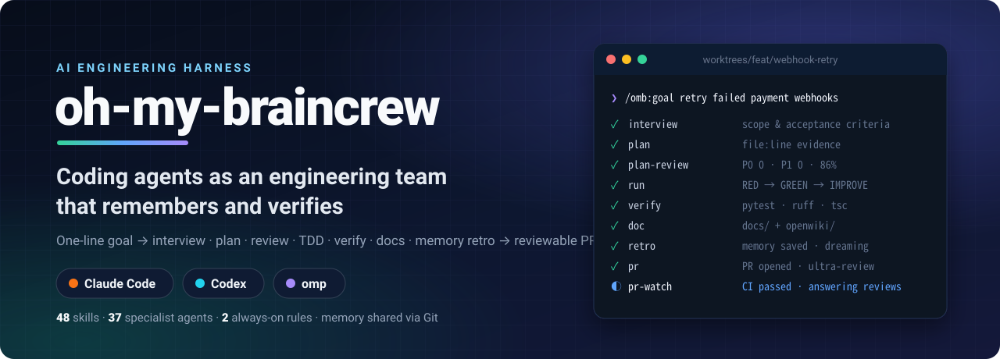
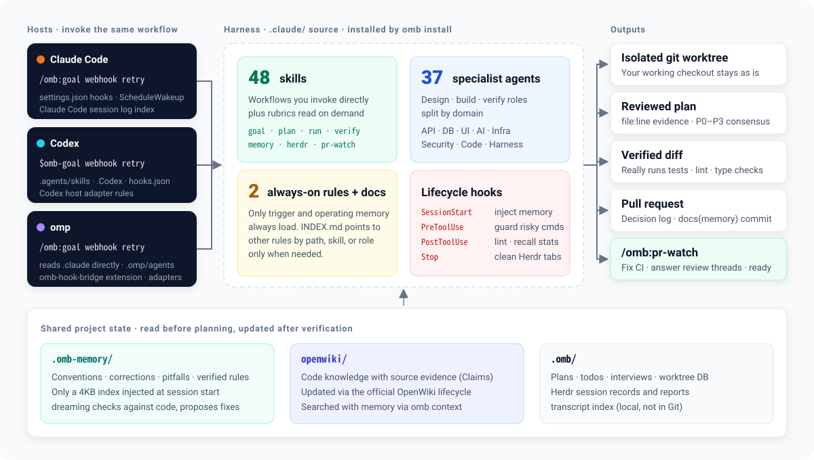
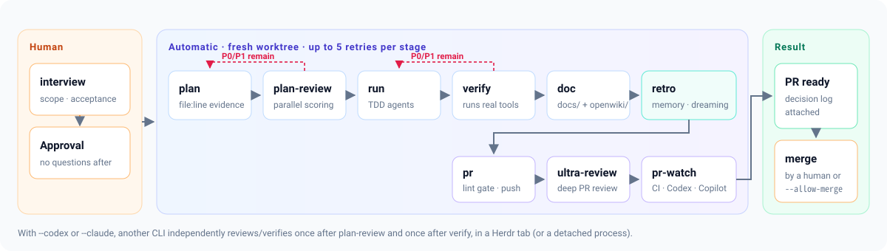
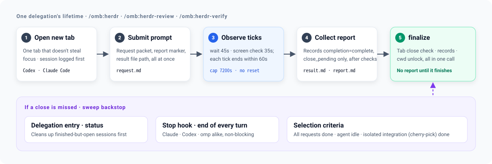
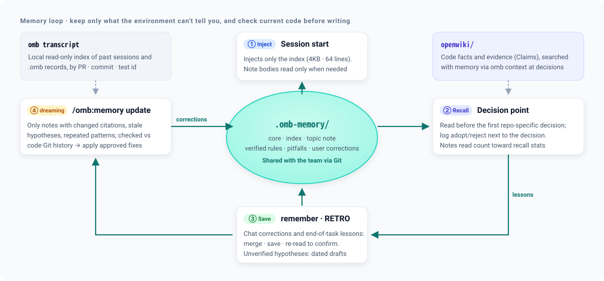

<div align="center">



<br>

**Turn Claude Code, Codex, or omp into an engineering team that plans, reviews, builds, verifies, opens the PR, and remembers how your project works.**

[](https://github.com/braincrew-lab/oh-my-braincrew-release/releases/latest)
[](https://github.com/braincrew-lab/oh-my-braincrew-release/releases)
[](#install)
[](#supported-hosts)
[](#memory-that-survives-the-session)
[](#license)

[Quick start](#quick-start) · [New in 2.1.0](#new-in-210) · [How it works](#how-it-works) · [Hosts](#supported-hosts) · [Workflow](#the-workflow) · [Commands](#commands) · [Memory](#memory-that-survives-the-session) · [Changelog](CHANGELOG.md) · [한국어](README-ko.md)

</div>

---

A single coding agent working in a single context will happily write code, skip the tests, and tell you it's done. **oh-my-braincrew (`omb`)** installs a harness around that agent: 48 workflow skills, 37 specialist agents, convention rules loaded by path when needed, and lifecycle hooks. Together they make the agent work like a team with a process.

You describe a goal. The harness interviews you, writes a plan anchored to real files, has domain reviewers score it, implements it test-first in an isolated worktree, and runs the real type checker, linter, and tests. Then it opens a pull request. The decisions and lessons from the run land in a Git-shared memory, so the next session and the next teammate start from them.

```text
> /omb:goal add retry logic to the payment webhook
```

## New in 2.1.0

| Change | What you get |
|---|---|
| **omp (oh-my-pi) support** | `omb install` and `update` generate omp agents (`.omp/agents/omb-*.md`), adapter and resident rules (`.omp/rules/`), and a hook bridge extension (`.omp/extensions/omb-hook-bridge/`). omp reads skills and `/omb:*` commands straight from `.claude/`. Safety and quality hooks, memory injection, and the per-role Bash gate run in omp sessions too |
| **Memory drives the workflow** | Workflow skills (interview, plan, run, verify, …) read memory before their first repository-dependent decision and save reusable lessons when they finish. `/omb:goal` and `/omb:refactoring` gain a **RETRO** step after DOC: it saves decisions and lessons, runs dreaming once, and leaves one `docs(memory)` commit in the same PR |
| **Herdr tabs close themselves** | When a delegation finishes, one `finalize` call closes the tab and clears its records and lock. Sessions that missed the close are swept on delegation entry, on `status`, and by a non-blocking `Stop` hook at the end of every turn. Concurrent delegations are observed in turn and closed as each finishes |
| **Waits that fit each host** | Herdr observation ticks and PR-watch waits are split into slices under 60 seconds, so turns no longer break on omp, which moves longer commands to the background |
| **Memory host diagnostics** | `omb memory status --host omp` is supported, and `status --json` names each warning in `warning_kinds`. `/omb:clean` suggests `/omb:memory update` only when dreaming is due, and `omb retention plan` when records pile up |
| **Official OpenWiki features** | Multi-repository wiki search (`openwiki_search`, `openwiki_read`), `INSTRUCTIONS.md` and `.openwikiignore` steering, language inheritance, and diagnostics are wired into the OMB routes |

Every entry is in the [CHANGELOG](CHANGELOG.md). Coming from before 2.0.0? Read [Upgrading from before 2.0.0](#upgrading-from-before-200) as well.

## Why omb

| Agent on its own | Agent with omb |
|---|---|
| One context does design, code, and review | Separate design, implement, and verify agents per domain: API, DB, UI, AI, Infra, Security |
| Plans are prose | Plans cite file paths and line ranges, then go through an evaluate → improve loop |
| "Looks good to me" | Domain reviewers score the plan in parallel and merge their findings into one P0–P3 list |
| "Tests should pass" | `/omb:verify` runs `pytest`, `ruff`, `tsc`, `eslint` and reports what the commands printed |
| Edits land in your working tree | Each goal runs in its own git worktree with tracked state |
| Every session starts from zero | Team conventions and lessons live in `.omb-memory/`, code facts in `openwiki/`, both in Git |
| Every rule loaded at once | A session starts with two resident rules and a 4 KB memory index; everything else loads by path, skill, or role when needed |

## Quick start

**1. Install the CLI**

```bash
# macOS (Apple Silicon) / Linux (x86_64)
curl -fsSL https://raw.githubusercontent.com/braincrew-lab/oh-my-braincrew-release/main/install.sh | bash
```

```powershell
# Windows (PowerShell)
irm https://raw.githubusercontent.com/braincrew-lab/oh-my-braincrew-release/main/install.ps1 | iex
```

Both scripts download the latest release, check its SHA-256 against `checksums-sha256.txt`, and add an `omb` shortcut. The binary goes to `~/.local/bin` on macOS/Linux and `%LOCALAPPDATA%\oh-my-braincrew` on Windows. No Python, `uv`, or source checkout is needed.

**2. Attach it to a project**

```bash
cd /path/to/your/project
omb version
omb install        # alias of `omb init`
```

`omb install` writes the `.claude/` harness plus the Codex and omp compatibility files. It creates `AGENTS.md` and `CLAUDE.md` only if they are missing; your own instructions, agents, skills, and settings are left alone.

**3. Start working** inside your agent:

| Host | Tune the project instructions | Run a goal |
|---|---|---|
| Claude Code | `/omb:deep-setup` | `/omb:goal add retry logic to the payment webhook` |
| Codex | `$omb-deep-setup` | `$omb-goal add retry logic to the payment webhook` |
| omp | `/omb:deep-setup` | `/omb:goal add retry logic to the payment webhook` |

`deep-setup` reads your real code, manifests, and CI, then writes root and folder-level `AGENTS.md` guidance. If new skills do not show up, restart the host session. Start omp from the project root so the adapter rules and the hook bridge load.

## How it works

<p align="center">
  
</p>

| Layer | What it is | Where it lives |
|---|---|---|
| **Skills** | The workflows you call (`/omb:plan`, `/omb:verify`, …) plus rubrics and reference guides loaded on demand | `.claude/skills/omb-*` |
| **Agents** | Design, implement, and verify specialists per domain, a shared explorer, critics, and plan evaluators | `.claude/agents/omb/` |
| **Rules** | Two resident rules (triggers and operational memory) plus owner documents read on demand; the root `INDEX.md` maps loading by path, skill, and role | `.claude/rules/` |
| **Hooks** | Handlers that run at session start (memory injection), around tool use (dangerous-command guard, lint, memory recall tally), and at the end of a main-session turn (Herdr tab sweep). They block only what must not slip through and pass the rest on as warnings | `.claude/hooks/omb/` |
| **State** | Plans, todo lists, interviews, worktree records, and Herdr session records | `.omb/` |

Covered stacks: Python/FastAPI, React/TypeScript, LangGraph/LangChain/Deep Agents, Postgres/Redis, and Docker/GitHub Actions/Kubernetes/Terraform.

## Supported hosts

All three hosts read the same `.claude/` source in their own way. Do not edit the generated compatibility files; change the `.claude/` source instead.

| | Claude Code | Codex | omp |
|---|---|---|---|
| Invocation | `/omb:goal` | `$omb-goal` | `/omb:goal` |
| Skills | `.claude/skills/` | generated `.agents/skills/` | `.claude/skills/` directly |
| Agents | `.claude/agents/omb/` | `.codex/agents/omb-*.toml` roles (registered in `.codex/config.toml`) | generated `.omp/agents/omb-*.md` |
| Hooks | `.claude/settings.json` | `.codex/hooks.json` | `omb-hook-bridge` extension |
| Session-start memory | SessionStart hook | generated hook config and AGENTS guidance | bridge injects into the main session only |
| Long waits | scheduled with `ScheduleWakeup` | bounded wait in the same turn | same-turn wait in slices under 60 s |
| Herdr delegation target | yes | yes | can start delegations, not a target |

omp 18.3.2 or later is required. On Windows, omp needs a POSIX `bash` on `PATH` to run the OMB hooks. If generated files drift, check or repair them with `omb codex-compat seed|verify --project-root <absolute path>` or `omb omp-compat seed|verify --project-root <absolute path>`.

## The workflow

Run the whole cycle with one call, or invoke any step on its own. Examples use the Claude Code and omp form; Codex calls the same skill as `$omb-plan`.

<p align="center">
  
</p>

| Step | Command | Result |
|---|---|---|
| 1 | `/omb:interview` | Searches the repo, wiki, and memory first, then settles only the open decisions → `.omb/interview/` |
| 2 | `/omb:plan` | Code-location-first plan with an evaluate → improve loop → `.omb/plans/`. `--level low\|medium\|high\|xhigh` (default `medium`) sets reviewer count and iterations |
| 3 | `/omb:plan-review` | Parallel domain reviewers and one consensus list with P0–P3 priorities |
| 4 | `/omb:run` | Tasks delegated to domain agents under RED → GREEN → IMPROVE → `.omb/todo/`. `--domain` runs a single domain |
| 5 | `/omb:verify` | Real `tsc` / `ruff` / `pytest` / `eslint` runs, domain review, one verdict |
| 6 | `/omb:doc` | `docs/` and the wiki updated to match the change |
| 7 | RETRO | The retrospective step of `/omb:goal` and `/omb:refactoring`: saves reusable decisions and lessons, runs dreaming, commits `docs(memory)` |
| 8 | `/omb:pr` | Branch check → lint gate → commit → push → GitHub PR |
| 9 | `/omb:pr-watch` | Fixes failing CI with new commits and replies to every review thread, then stops on a verdict |

### `/omb:goal`: the whole cycle in one call

You set scope and acceptance criteria in the opening interview and approve once. From there it asks nothing more: in a fresh worktree it runs plan → plan-review → run → verify → doc → retro → pr → ultra-review → pr-watch, retrying each phase up to five times.

- After the PR opens, `omb-ultra-review` reviews it in depth and fixes what it finds; failing CI is fixed, and every Codex or Copilot review comment gets a fix or a reasoned reply before the PR is marked ready.
- It does not merge by default. Only a run started with `--allow-merge` placed **before** the goal text merges, and only after the merge gate passes.
- Decisions it makes on its own are attached to the PR body as a decision log. Resume an interrupted run with `/omb:goal --resume <todo path>`.
- Add `--codex` or `--claude` for one independent review after plan-review and one independent verification after verify by the other CLI: in a new tab inside [Herdr](https://herdr.dev), or in a detached process from a plain terminal.

```text
/omb:goal --allow-merge add retry logic to the payment webhook
```

Not every change needs the full pipeline. `/omb:plan` starts with a necessity gate, so a one-file edit does not summon a panel of reviewers.

## Commands

Claude Code and omp use `/omb:<name>`. Codex calls the same skills as `$omb-<name>`.

<details open>
<summary><strong>Plan, build, verify</strong></summary>

| Command | What it does |
|---|---|
| `/omb:goal` | One goal through interview → plan → review → run → verify → doc → retro → pr → pr-watch, autonomously |
| `/omb:interview` | Researches the repo first and settles only the remaining requirements and decisions; explores intent first for vague topics |
| `/omb:plan` | Implementation plan with an evaluate → improve loop (`--level`, `--worktree`, `--codex`) |
| `/omb:plan-review` | Multi-agent review of an existing plan with P0–P3 scoring |
| `/omb:run` | Execute a plan through domain agents with TDD enforced; `--domain api\|db\|ui\|ai\|infra\|security\|code` runs one domain |
| `/omb:verify` | Static analysis, tests, multi-agent consensus, P0/P1 auto-fix |
| `/omb:fix` | Bug-fix plan from a reproduction, git history, and root-cause analysis |
| `/omb:refactoring` | Autonomous refactoring pipeline with design and behavior-preservation checks |
| `/omb:architect` | File and directory architecture analysis, hotspots, and target design |

</details>

<details>
<summary><strong>Review, PR, release</strong></summary>

| Command | What it does |
|---|---|
| `/omb:pr` | Branch validation, lint gate, structured PR |
| `/omb:pr-watch` | Fix CI, answer every review thread and comment, stop on a verdict |
| `/omb:review-pr` | Review a PR diff against the original request and post an evidence comment |
| `/omb:ultra-review` | Deep review of a PR or local work, with fixes |
| `/omb:lint-check` | Detect the stack from changed files and run the matching linters |
| `/omb:release` | Version bump, changelog, tag, and GitHub Release |
| `/omb:issue` | Scan the codebase with parallel explorers and file issues |
| `/omb:issue-maintainer` | Normalize, prioritize, and consolidate existing issues |

</details>

<details>
<summary><strong>Knowledge, memory, docs, setup</strong></summary>

| Command | What it does |
|---|---|
| `/omb:memory` | "Remember this" / "forget" saves, and the `update` (dreaming) check |
| `/omb:wiki` | Read, update, and lint the `openwiki/` knowledge store |
| `/omb:doc` | Write or update `docs/` |
| `/omb:explain` | Explain what just happened, or a named topic or file |
| `/omb:mermaid` | Mermaid diagrams for designs, docs, and PRs |
| `/omb:setup` · `/omb:deep-setup` | Scaffold `.omb/`, `AGENTS.md`, and `CLAUDE.md`; refine an existing project's instructions |
| `/omb:worktree` · `/omb:clean` | Create, inspect, and resume isolated worktrees; remove worktrees and branches with merge evidence |
| `/omb:harness` | Create, verify, or fix agents, skills, hooks, and rules |
| `/omb:prompt-review` | Score and improve prompts, agent bodies, and skill bodies |

</details>

<details>
<summary><strong>Second opinions: Codex and Herdr</strong></summary>

| Command | What it does |
|---|---|
| `/omb:codex <task>` | Delegate a task to the Codex CLI; `--review` reviews local changes, `--adv-review` hunts for failure modes |
| `/omb:herdr --codex <request>` | Run a request in Codex or Claude Code in a new [Herdr](https://herdr.dev) tab and close the tab once the result is collected |
| `/omb:herdr-review` · `/omb:herdr-verify` | Independent plan/code review, or requirements verification, by another CLI; a detached process outside Herdr |
| `/omb:herdr-cronjob` | Schedule recurring Codex or Claude CLI runs and manage their logs |

</details>

### Herdr delegation

<p align="center">
  
</p>

- A delegated agent may touch only the tabs and panes it created. Each observation tick stays under 60 seconds, and a turn is capped at 7,200 seconds.
- Once the result is in, one `finalize` call closes the tab and clears the session and request records and the lock.
- Sessions that missed the close are cleaned by the `sweep` on delegation entry, on `status`, and in the `Stop` hook at the end of every turn. Sessions still carrying isolated commits over are left alone.
- Herdr and cron jobs delegate only to Codex or Claude Code. omp can start a delegation but is not a target.

## Memory that survives the session

The next session, and the next teammate, should know how this project works without being told again.

<p align="center">
  
</p>

```bash
omb memory init   --root /absolute/project
omb memory status --root /absolute/project --host claude   # or codex, omp
```

Then just say it:

> Remember this: when a public API changes, check the frontend consumers and the contract tests too.

- **Inject.** A session starts with a small index of at most 4 KB and 64 lines. Claude Code uses the SessionStart hook; on omp the hook bridge injects it into the main session only.
- **Recall.** Workflow skills read memory before their first repository-dependent decision and record next to the decision whether they adopted or rejected it.
- **Save.** Requests made mid-conversation and lessons from the end of a task are merged, saved, and read back. Unverified hypotheses stay as dated drafts and are not injected at session start.
- **Dreaming.** `/omb:memory update` checks notes whose cited code changed, aging hypotheses, and repeated mistakes against code, Git, and records, and proposes fixes. Only what you approve is applied; `/omb:goal` and `/omb:refactoring` run it once in their RETRO step.
- **Shared through Git.** Commit `.omb-memory/` like any other file. Mid-conversation saves and `/omb:memory update` never commit; only RETRO and the fix loops of `/omb:pr-watch` and `/omb:ultra-review` do.
- **No vector database.** Memory and the `openwiki/` knowledge store are searched locally:

```bash
omb context search "authentication" --root /absolute/project
omb transcript search "worktree timeout" --limit 3 --root /absolute/project
omb transcript find "PR #392" --root /absolute/project
```

`omb memory status` warns when a check is due (`dream_due`, `hypothesis_age`), the wiki is stale (`wiki_stale`), or records pile up (`retention_due`), and lists them in `warning_kinds`. `omb retention plan` deletes nothing and only shows what would go; `apply` removes only records in the transcript index and keeps open work, unresolved failures, and Git-tracked files.

## CLI reference

| Command | Purpose |
|---|---|
| `omb install [path]` / `omb init [path]` | Install harness files into a project |
| `omb update [path]` | Update the binary and refresh harness files (`--force` reapplies) |
| `omb uninstall` | Remove harness files and the binary (`--dry-run`, `--keep-binary`, `--project-dir`) |
| `omb version` | Print the installed version |
| `omb memory <sub>` | Initialize, read, search, update, and validate operational memory (`init`, `status`, `check`, …) |
| `omb context search\|build\|status` | Search wiki and memory, then build and reuse workflow context bundles |
| `omb transcript index\|search\|find\|status` | Search past sessions and `.omb` records by evidence id (read-only) |
| `omb wiki status` | Report `openwiki/` publication state and Claim freshness |
| `omb retention plan\|apply\|status` | Clean up accumulated `.omb` records and Herdr Cron run records |
| `omb codex-compat seed\|verify` · `omb omp-compat seed\|verify` | Check or repair the generated files of each host |
| `omb update-gitignore` | Re-apply the harness ignore block |

## Configuration

Two environment variables are read as settings; timeouts, retries, and the rest are fixed in the rule files. The shell environment wins over `.claude/settings.local.json`, which wins over `.claude/settings.json`.

| Variable | Purpose |
|---|---|
| `OMB_DOCUMENTATION_LANGUAGE` | Language for replies and docs (`en` / `ko`). Code, prompts, and commit messages stay English |
| `CLAUDE_CODE_EXPERIMENTAL_AGENT_TEAMS` | Whether Claude Code's agent team feature is used |

Keep secrets out of shared instructions and memory.

## Install

### Requirements

- At least one of [Claude Code](https://docs.anthropic.com/en/docs/claude-code), [Codex](https://github.com/openai/codex), or omp (oh-my-pi, 18.3.2 or later), installed and authenticated
- `git`, plus an authenticated [`gh`](https://cli.github.com) for PR, issue, and release workflows
- Node.js and npm, if you use the OpenWiki knowledge store
- A POSIX `bash` on `PATH`, if you use omp on Windows

### Manual download

| Platform | Binary |
|---|---|
| macOS (Apple Silicon) | [`oh-my-braincrew-v2.1.0-darwin-arm64`](https://github.com/braincrew-lab/oh-my-braincrew-release/releases/latest) |
| Linux (x86_64) | [`oh-my-braincrew-v2.1.0-linux-amd64`](https://github.com/braincrew-lab/oh-my-braincrew-release/releases/latest) |
| Windows (x86_64) | [`oh-my-braincrew-v2.1.0-windows-amd64.exe`](https://github.com/braincrew-lab/oh-my-braincrew-release/releases/latest) |

Each release also ships `harness-vX.Y.Z.tar.gz` (the harness that `omb install` lays down), its `.sha256` sidecar, and `checksums-sha256.txt`. Verify a manual download before running it:

```bash
shasum -a 256 -c checksums-sha256.txt --ignore-missing
```

### What install and update touch

- **Updated:** omb-owned paths only: `.claude/skills/omb*/`, `.claude/agents/omb/`, `.claude/hooks/omb/`, `.claude/commands/omb/`, `.claude/rules/**`, the generated Codex files (`.agents/skills/`, the OMB files under `.codex/`), and the generated omp files (`.omp/agents/omb-*.md`, `.omp/rules/omb-*.md`, `.omp/extensions/omb-hook-bridge/`, with ownership recorded in `.omb/compat/omp-manifest.json`).
- **Preserved:** your `AGENTS.md`, `CLAUDE.md`, settings, your own agents and skills, and `.claude/rules/custom/`.
- Installed harness files and local work state are excluded from Git. Your instructions and `.omb-memory/` are meant to be committed.
- `.omp/agents/`, `.omp/rules/`, and `.omp/extensions/` are excluded from Git as whole directories. To share a file you put there yourself, add it with `git add -f`.
- If omp generation fails, install continues and leaves an `[omb] omp-compat: skipped: …` warning.

### Update and uninstall

```bash
omb update                # new binary + refreshed harness
omb uninstall --dry-run   # preview what will be removed
omb uninstall             # remove harness files and the binary
```

An update downloads nothing when you are already current, and never downgrades a CLI newer than the latest release. After an update that changes hooks, Codex asks once whether to trust `.codex/hooks.json`.

### Upgrading from before 2.0.0

Applies only when coming from a version older than 2.0.0.

- **[breaking] The agent `memory:` field is gone.** `Edit(.claude/agent-memory/**)` allow rules are cleaned up on install and update. Move notes left in `.claude/agent-memory/` into `.omb-memory/` with `omb memory apply`.
- **Only two rules stay resident.** If your own skills or agents assumed other rules were always loaded, have them read the owner file instead.
- **Run `omb memory init` once if `.omb-memory/` exists.** The on-disk index format is unchanged, so memory keeps working while teammates update at different times.

### Troubleshooting

- **`omb: command not found`**: add `~/.local/bin` to your `PATH`.
- **macOS blocks the binary**: run `xattr -d com.apple.quarantine ~/.local/bin/oh-my-braincrew`.
- **Skills missing after install or update**: restart the Claude Code, Codex, or omp session.
- **Hooks not running on omp**: start omp from the project root, then check the generated files with `omb omp-compat verify --project-root <absolute path>`.
- **Windows limits**: `omb pr-watch` and `omb uninstall` do not run on Windows yet, so the `--allow-merge` merge step does not work there either.

## Changelog

Release notes for every version are in [CHANGELOG.md](CHANGELOG.md) and on the [Releases](https://github.com/braincrew-lab/oh-my-braincrew-release/releases) page.

## License

**Braincrew Internal Use Only.** This repository distributes prebuilt binaries and the harness tarball; the source lives in a private repository. Only parties authorized in writing by Braincrew Inc. may use it. See [LICENSE](LICENSE) for the full terms.
